# Calorie Track AI Bot - System Architecture

## Overview

The Calorie Track AI Bot is a comprehensive Telegram Mini App that uses AI-powered computer vision to analyze food photos and provide detailed nutritional information. The system features a modern, mobile-first design with automatic theme detection, multi-language support, and enterprise-grade observability. The architecture prioritizes scalability, performance, and developer experience.

## High-Level Architecture

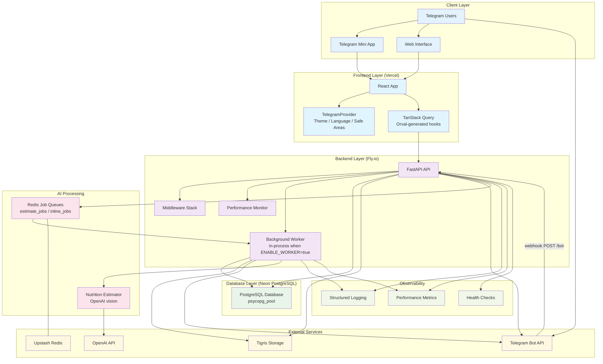

## Inline Mode Pipeline

Inline photo analysis introduces an additional fast-path inside the existing architecture. The diagram below highlights the components that participate in the inline acknowledgement (≤3 s) and result delivery (≤10 s) SLAs while maintaining the 24 hour retention boundary for transient artifacts.

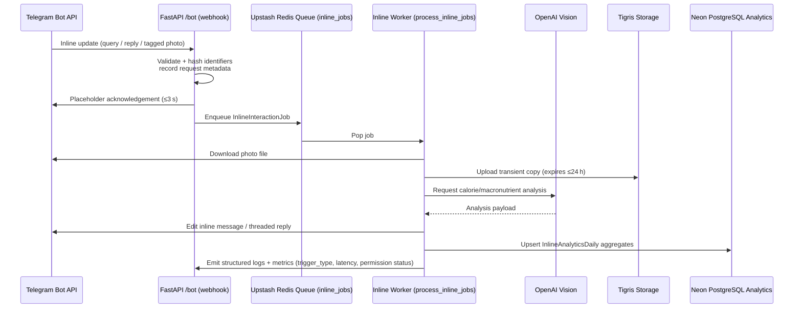

**Throughput target**: the inline queue is dimensioned for 60 jobs per minute with bursts up to 5 RPS across active groups (`INLINE_THROUGHPUT_PER_MIN` / `INLINE_BURST_RPS`). `enqueue_inline_job` enforces these limits with Redis counters and raises `InlineQueueThrottleError` when exceeded. There is no autoscaling logic in the codebase; in production both workers run as asyncio tasks inside the API process.

**Privacy boundary**: chat and user identifiers are salted (`INLINE_HASH_SALT`) + hashed before they are enqueued, and only aggregate analytics (success/failure counts, latency, accuracy within tolerance, permission block counts) reach PostgreSQL (`inline_analytics_daily`). Transient photos are uploaded to Tigris under the `inline/` prefix. `storage.purge_transient_media()` deletes objects older than 24 hours, but nothing in the codebase schedules it yet.

## Component Architecture

### Frontend Architecture

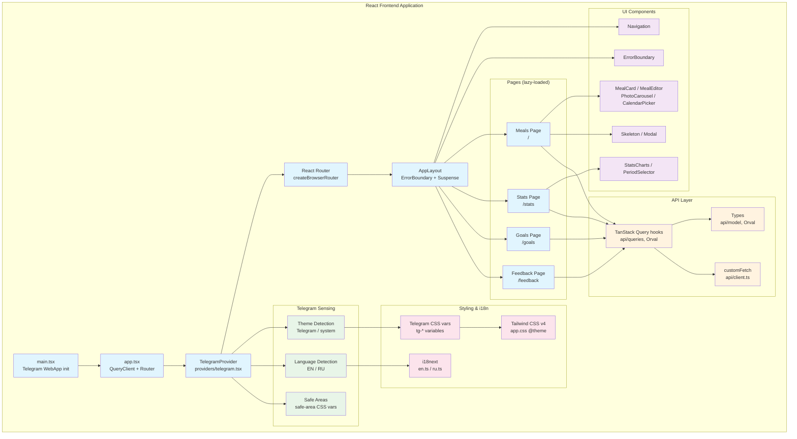

Server state is managed entirely by TanStack Query; there is no global client-side store. `api/client.ts` attaches `X-Correlation-ID` and `Authorization: tma <initData>` (or `x-user-id` in dev builds outside Telegram) to every request.

### Backend Architecture

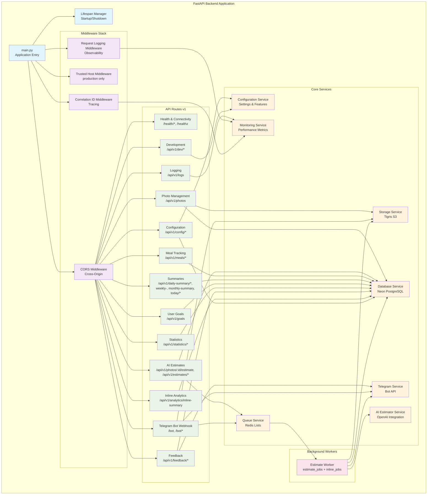

## Data Flow Architecture

### Photo Upload and Processing Flow

Photos enter through the Telegram bot, not the Mini App. The Mini App only reads and edits the resulting meals. (`POST /api/v1/photos` and `POST /api/v1/photos/{id}/estimate` exist for presigned-upload clients but the frontend does not call them.)

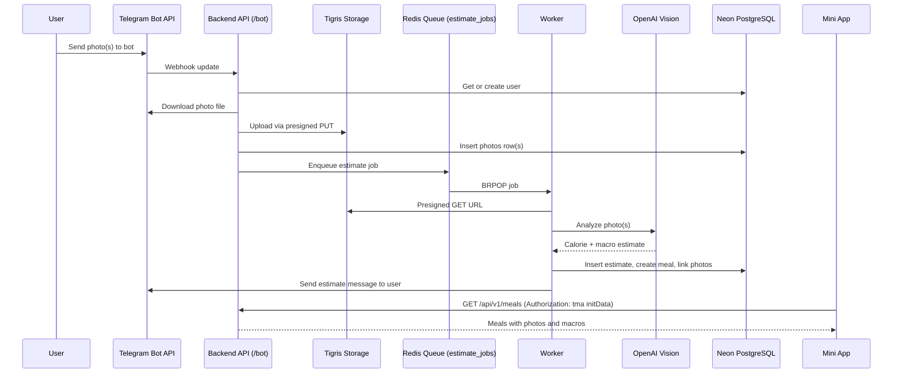

### Authentication Flow

There is no session or token exchange. On every request the Mini App sends Telegram's signed launch data (`initData`) as `Authorization: tma <initData>`. The backend verifies its HMAC signature with `TELEGRAM_BOT_TOKEN`, rejects data older than 24 hours, and takes the Telegram user ID from it.

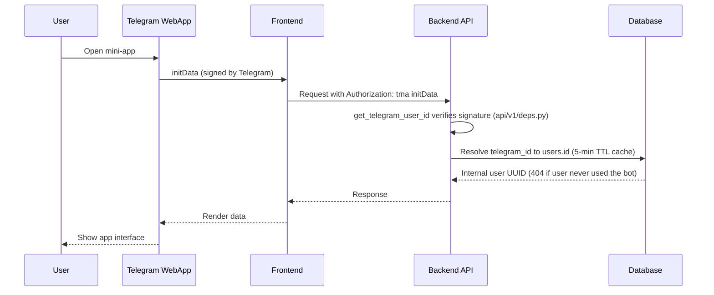

## Deployment Architecture

### Development Environment

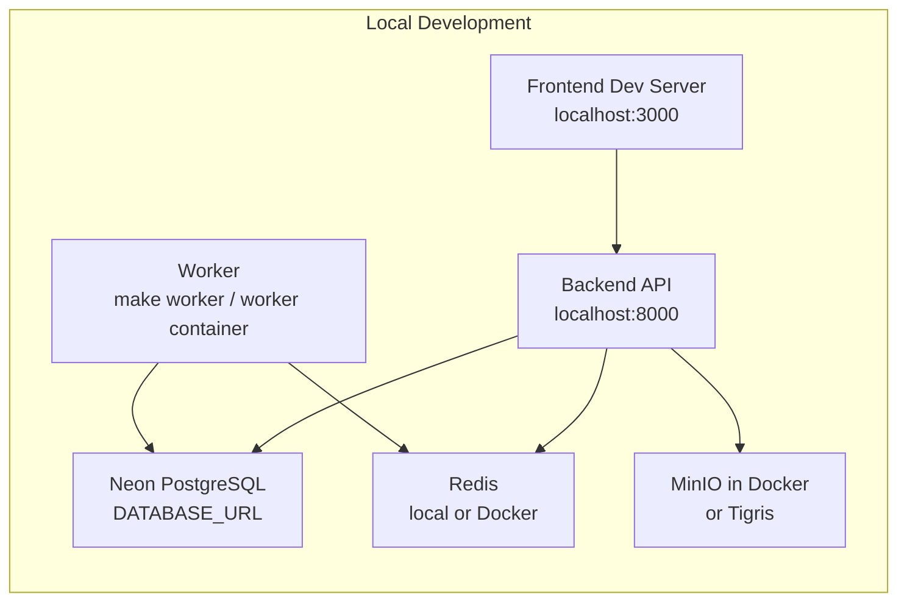

### Production Environment

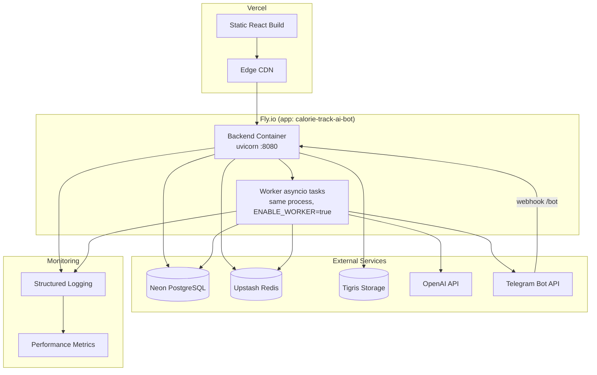

The backend image is built by `backend-build.yml` (Dockerfile `runtime` stage), pushed to GHCR, and deployed with `flyctl deploy --image` by `backend-deploy.yml`. The frontend is built and deployed with the Vercel CLI by `frontend-deploy.yml`.

## Environment Configuration

### Development vs Production

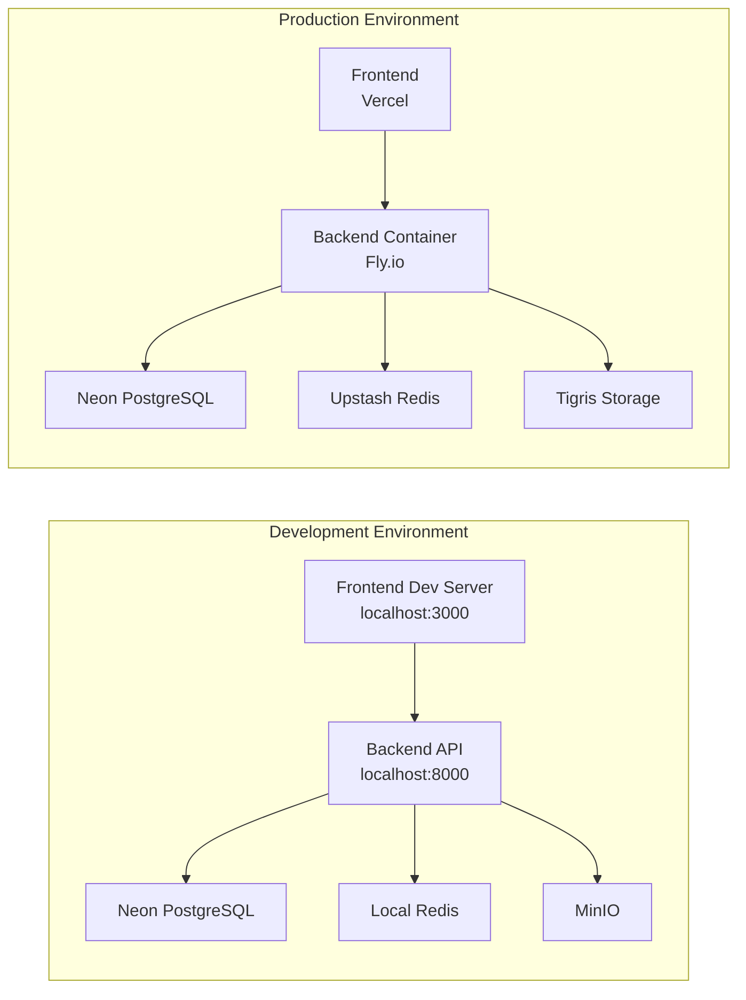

## Integration Points

### Frontend-Backend Integration

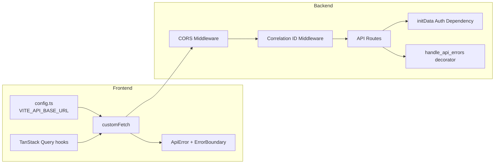

The frontend API client is generated by Orval from `frontend/openapi.json`, which is exported from the FastAPI app with `make -C backend openapi-export`.

## Technology Stack

### Frontend Technologies
- **React 19**: Function components with hooks, lazy-loaded pages
- **TypeScript 5.9**: Type-safe development with strict mode
- **Vite 7**: Build tool and dev server
- **Bun**: Package manager and script runner
- **React Router 7**: Client-side routing
- **TanStack Query**: Server state, using hooks generated by **Orval** from the OpenAPI spec
- **Custom fetch client**: Adds correlation ID and Telegram `initData` (`x-user-id` in dev outside Telegram) headers
- **Tailwind CSS v4**: CSS-first theming bound to Telegram `--tg-*` variables
- **Telegram WebApp API**: Native Telegram Mini App integration
- **i18next**: Internationalization (English/Russian)
- **Recharts / react-day-picker**: Stats charts and meal calendar

### Backend Technologies
- **FastAPI**: Modern Python web framework (OpenAPI 3.1)
- **Python 3.12**: Latest Python with type hints
- **Neon PostgreSQL**: Serverless PostgreSQL database (via psycopg3 + psycopg_pool, raw SQL)
- **Upstash Redis**: Serverless Redis for job queues and inline rate limiting
- **Tigris**: S3-compatible object storage (boto3)
- **OpenAI API**: GPT-5-mini (`OPENAI_MODEL`) for nutrition analysis
- **Telegram Bot API**: Bot functionality and webhooks (httpx client)
- **Structlog**: Structured logging with correlation IDs
- **Pydantic v2**: Data validation and serialization
- **psutil**: System monitoring and performance metrics

### Infrastructure Technologies
- **Fly.io**: Container deployment platform for backend
- **Vercel**: Edge deployment for frontend
- **Docker**: Containerization with multi-stage builds
- **Neon**: Serverless PostgreSQL with branching
- **GitHub Actions**: CI/CD pipeline
- **Performance Monitoring**: Real-time metrics collection
- **Health Checks**: `/health/live`, `/health/ready`, `/health/connectivity`, `/healthz` (Fly check)
- **Correlation IDs**: Request tracing via `x-correlation-id`

## Security Architecture

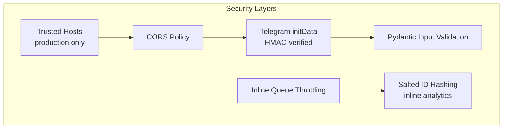

Note: the unsigned `x-user-id` header is accepted only when no `initData` is sent and the backend runs with `ALLOW_INSECURE_USER_ID_HEADER=true` (local development). Never enable it in production: anyone could then act as any user.

## Performance Architecture

### Caching Strategy

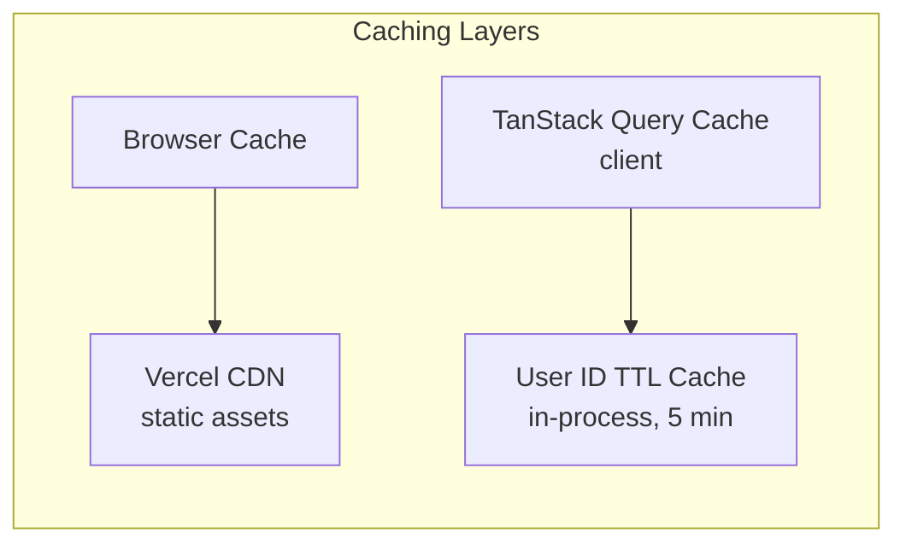

### Optimization Strategies
- **Frontend**: Code splitting, lazy loading, image optimization
- **Backend**: Database indexing, query optimization, connection pooling
- **Infrastructure**: CDN distribution, container optimization
- **Monitoring**: Performance metrics, resource usage tracking

## Monitoring and Observability

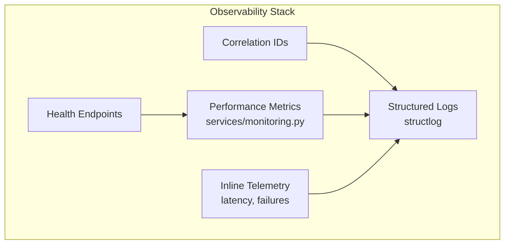

## Development Workflow

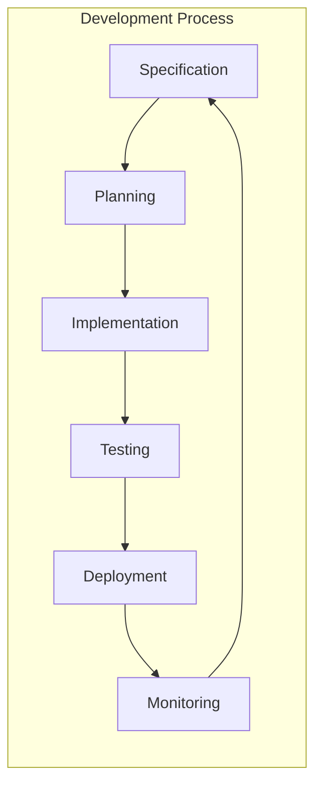

This architecture documentation provides a comprehensive view of the Calorie Track AI Bot system, showing how all components interact and work together to deliver a robust, scalable, and maintainable application.
