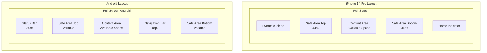
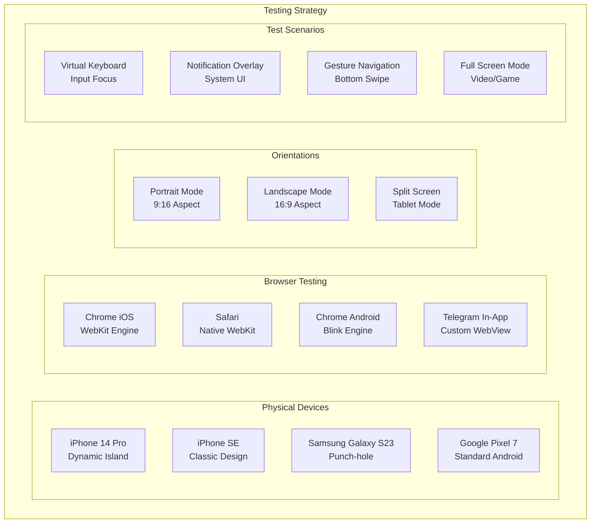

# Mobile Safe Areas Guide

## Overview

This guide provides comprehensive information about implementing mobile safe areas in the Calorie Track AI Bot Telegram Mini App. Safe areas ensure that important UI elements are not obscured by device-specific features like notches, dynamic islands, home indicators, and status bars.

## Understanding Safe Areas

### What are Safe Areas?



### Device-Specific Safe Areas

| Device | Top Safe Area | Bottom Safe Area | Notes |
|--------|---------------|------------------|-------|
| iPhone 14 Pro | 44px | 34px | Dynamic Island |
| iPhone 14 | 44px | 34px | Notch |
| iPhone SE | 20px | 0px | Classic design |
| Samsung Galaxy S23 | 24px | 48px | Punch-hole camera |
| Google Pixel 7 | 24px | 48px | Standard Android |

## Architecture Overview

### Safe Area Handling

Safe areas are handled primarily in CSS. There is no `SafeAreaWrapper` component or `useSafeAreaDetection` hook; the JavaScript side is a small part of `TelegramProvider` in `frontend/src/providers/telegram.tsx`.

```mermaid
graph TD
    subgraph "Safe Area Handling"
        META[index.html<br/>viewport-fit=cover]
        CSS_VARS[app.css<br/>--safe-area-* from env()]

        subgraph "Layout (Tailwind arbitrary values)"
            LAYOUT[AppLayout main<br/>pt-var --safe-area-top]
            NAV[Navigation<br/>pb-var --safe-area-bottom]
        end

        subgraph "React Context"
            PROVIDER[TelegramProvider<br/>getSafeAreas on mount + resize]
            HOOK[useTelegram().safeAreas]
        end
    end

    META --> CSS_VARS
    CSS_VARS --> LAYOUT
    CSS_VARS --> NAV
    CSS_VARS --> PROVIDER
    PROVIDER --> HOOK

    %% Styling
    classDef app fill:#e1f5fe
    classDef ui fill:#fff3e0
    classDef state fill:#e8f5e8

    class META,CSS_VARS app
    class LAYOUT,NAV ui
    class PROVIDER,HOOK state
```

Safe area values are not synced to the backend. The backend UI configuration (`/api/v1/config/ui`) has `safe_area_top/bottom/left/right` fields, but the frontend does not call that endpoint.

## Implementation Guide

### 1. Viewport Meta Tag

`frontend/index.html` opts into edge-to-edge rendering so `env(safe-area-inset-*)` returns non-zero values on notched devices:

```html
<meta name="viewport" content="width=device-width, initial-scale=1.0, maximum-scale=1.0, user-scalable=no, viewport-fit=cover" />
```

### 2. CSS Custom Properties

`frontend/src/app.css` maps the CSS environment variables to app-level custom properties when `env()` is supported:

```css
/* frontend/src/app.css */
@supports (padding-top: env(safe-area-inset-top)) {
  :root {
    --safe-area-top: env(safe-area-inset-top);
    --safe-area-bottom: env(safe-area-inset-bottom);
    --safe-area-left: env(safe-area-inset-left);
    --safe-area-right: env(safe-area-inset-right);
  }
}
```

### 3. Applying Insets in Layout

Components consume the variables through Tailwind CSS v4 arbitrary values, with a `0px` fallback when unsupported:

```tsx
// frontend/src/components/layout/AppLayout.tsx
<main className="flex-1 pb-16 pt-[var(--safe-area-top,0px)]">

// frontend/src/components/layout/Navigation.tsx (fixed bottom bar)
<nav className="fixed bottom-0 left-0 right-0 z-50 flex ... pb-[var(--safe-area-bottom,0px)]">
```

Only the top (main content) and bottom (navigation bar) insets are applied today; left/right insets are defined but not used by any component.

### 4. Reading Insets in JavaScript

`TelegramProvider` reads the custom properties into context on mount and on `window` `resize`, and exposes them via `useTelegram()`:

```typescript
// frontend/src/providers/telegram.tsx
function getSafeAreas(): SafeAreaInsets {
  if (typeof document === "undefined")
    return { top: 0, bottom: 0, left: 0, right: 0 };
  const style = getComputedStyle(document.documentElement);
  return {
    top: parseFloat(style.getPropertyValue("--safe-area-top")) || 0,
    bottom: parseFloat(style.getPropertyValue("--safe-area-bottom")) || 0,
    left: parseFloat(style.getPropertyValue("--safe-area-left")) || 0,
    right: parseFloat(style.getPropertyValue("--safe-area-right")) || 0,
  };
}

// inside TelegramProvider
useEffect(() => {
  const handleResize = () => setSafeAreas(getSafeAreas());
  window.addEventListener("resize", handleResize);
  return () => window.removeEventListener("resize", handleResize);
}, []);
```

Usage:

```typescript
const { safeAreas } = useTelegram(); // { top, bottom, left, right } in px
```

No component currently consumes `safeAreas`; layout relies on the CSS variables directly. The provider does not listen to `orientationchange`, `visualViewport` resize, or Telegram `safeAreaChanged` / `contentSafeAreaChanged` events.

## Testing Safe Areas

### Device Testing Matrix



### Automated Testing

E2E coverage lives in `frontend/tests/e2e/safe-areas.spec.ts`. It runs under the `iPhone 14 Pro`, `iPhone SE`, `Samsung Galaxy S23`, and `iPad Pro` Playwright projects (see `frontend/playwright.config.ts`), and inside each project it iterates its own viewport list (`iPhone 12`, `iPhone 12 Landscape`, `Android Pixel 5`, `iPad Air`) via `page.setViewportSize`. It mocks `window.Telegram.WebApp` before navigation.

Test groups: CSS `env()` support, safe-area wrapper styling, overlap with system UI, dynamic changes on `resize`, orientation changes, Telegram theme integration, performance, accessibility/touch targets, and cross-browser consistency.

Note: several assertions look for `[data-safe-area-supported]` or `.safe-area-wrapper` elements, which the current app does not render. Those checks are guarded by `if (count > 0)` or only assert `toBeDefined()`, so they pass without exercising real layout.

```bash
cd frontend
bun run test:e2e safe-areas
```

## Browser Support

### CSS env() Support

| Browser | Support | Notes |
|---------|---------|-------|
| Safari iOS 11.2+ | ✅ Full | Native support |
| Chrome iOS 85+ | ✅ Full | WebKit-based |
| Safari macOS | ✅ Partial | Desktop support limited |
| Chrome Android 69+ | ✅ Full | Android support |
| Firefox | ❌ Limited | Partial support |
| Samsung Internet | ✅ Full | Chromium-based |

### Fallback Strategy

```javascript
// Feature detection and fallbacks
function detectSafeAreaSupport() {
  // Check for CSS env() support
  if (CSS.supports('padding: env(safe-area-inset-top)')) {
    return 'native';
  }

  // Check for Visual Viewport API
  if ('visualViewport' in window) {
    return 'viewport-api';
  }

  // Check for orientation API
  if ('orientation' in screen) {
    return 'orientation-api';
  }

  // Fallback to user agent detection
  return 'user-agent';
}
```

## Best Practices

### 1. Design Guidelines

- **Always test on real devices** - Simulators may not accurately represent safe areas
- **Design for the smallest safe area** - Ensure content is visible on all devices
- **Use flexible layouts** - Avoid fixed positioning that might conflict with safe areas
- **Consider landscape mode** - Safe areas change significantly in landscape orientation

### 2. Performance Considerations

- **Debounce resize events** - Avoid excessive recalculations during orientation changes (the `TelegramProvider` resize handler is not debounced)
- **Use CSS when possible** - Native CSS env() is more performant than JavaScript
- **Cache safe area values** - Store detected values to avoid repeated calculations
- **Minimize DOM updates** - Batch safe area changes to reduce layout thrashing

### 3. User Experience

- **Smooth transitions** - Animate safe area changes for better UX
- **Visual feedback** - Show safe area boundaries during development
- **Consistent spacing** - Maintain visual hierarchy within safe areas
- **Touch targets** - Ensure interactive elements are within safe areas

## Debugging Safe Areas

### Development Tools

Example overlay (not part of the codebase; paste into a component temporarily):

```typescript
// Debug utility for development
export const SafeAreaDebugger = () => {
  const [debugMode, setDebugMode] = useState(false);
  const { safeAreas } = useTelegram();

  if (!debugMode) {
    return (
      <button
        onClick={() => setDebugMode(true)}
        style={{
          position: 'fixed',
          top: '10px',
          right: '10px',
          zIndex: 9999,
        }}
      >
        Show Safe Areas
      </button>
    );
  }

  return (
    <div style={{
      position: 'fixed',
      top: 0,
      left: 0,
      right: 0,
      bottom: 0,
      pointerEvents: 'none',
      zIndex: 9999,
    }}>
      {/* Top safe area */}
      <div style={{
        position: 'absolute',
        top: 0,
        left: 0,
        right: 0,
        height: `${safeAreas.top}px`,
        backgroundColor: 'rgba(255, 0, 0, 0.3)',
        border: '1px solid red',
      }} />

      {/* Bottom safe area */}
      <div style={{
        position: 'absolute',
        bottom: 0,
        left: 0,
        right: 0,
        height: `${safeAreas.bottom}px`,
        backgroundColor: 'rgba(255, 0, 0, 0.3)',
        border: '1px solid red',
      }} />

      {/* Debug info */}
      <div style={{
        position: 'absolute',
        top: '50%',
        left: '50%',
        transform: 'translate(-50%, -50%)',
        backgroundColor: 'rgba(0, 0, 0, 0.8)',
        color: 'white',
        padding: '10px',
        borderRadius: '5px',
        fontFamily: 'monospace',
        pointerEvents: 'auto',
      }}>
        <div>Top: {safeAreas.top}px</div>
        <div>Bottom: {safeAreas.bottom}px</div>
        <div>Left: {safeAreas.left}px</div>
        <div>Right: {safeAreas.right}px</div>
        <button onClick={() => setDebugMode(false)}>
          Hide
        </button>
      </div>
    </div>
  );
};
```

### Console Debugging

Paste into the browser console (the app does not define `window.debugSafeAreas`):

```javascript
// Console commands for debugging
window.debugSafeAreas = () => {
  console.log('Safe Area Debug Info:');
  console.log('CSS env() support:', CSS.supports('padding: env(safe-area-inset-top)'));
  console.log('Visual Viewport:', window.visualViewport);
  console.log('Screen dimensions:', {
    width: window.screen.width,
    height: window.screen.height,
    availWidth: window.screen.availWidth,
    availHeight: window.screen.availHeight,
  });
  console.log('Viewport dimensions:', {
    innerWidth: window.innerWidth,
    innerHeight: window.innerHeight,
    visualViewport: window.visualViewport ? {
      width: window.visualViewport.width,
      height: window.visualViewport.height,
    } : 'Not supported',
  });
};
```

## Common Issues and Solutions

### Issue 1: Safe Areas Not Detected

**Problem**: Safe area insets are returning 0 on devices that should have safe areas.

**Solutions**:
1. Check viewport meta tag includes `viewport-fit=cover` (already set in `frontend/index.html`)
2. Verify CSS support: Use feature detection for env() support
3. Test on real devices: Simulators may not accurately represent safe areas

### Issue 2: Inconsistent Behavior Across Browsers

**Problem**: Different browsers report different safe area values.

**Solutions**:
1. Implement fallback detection methods
2. Use progressive enhancement approach
3. Test across multiple browser engines

### Issue 3: Performance Issues During Orientation Changes

**Problem**: Frequent recalculation of safe areas causes performance issues.

**Solutions**:
1. Debounce resize event handlers
2. Use CSS-based solutions when possible
3. Cache calculated values

This comprehensive guide ensures that your Telegram Mini App provides an optimal experience across all mobile devices by properly handling safe areas and device-specific UI constraints.
